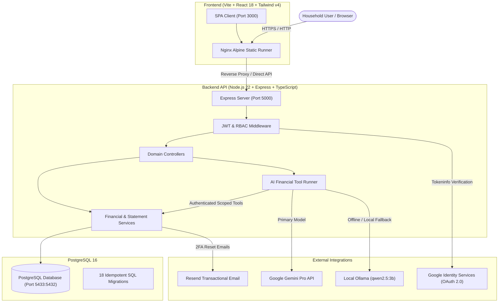

# Family Finance — Modern Full-Stack Financial Operating System

[](https://github.com/Archit-vijay/Family-Expense-Tracker/actions/workflows/ci.yml)
[](https://github.com/Archit-vijay/Family-Expense-Tracker/pkgs/container/family-expense-tracker-backend)
[](https://react.dev/)
[](https://www.typescriptlang.org/)
[](https://nodejs.org/)
[](https://www.postgresql.org/)
[](https://tailwindcss.com/)
[](https://deepmind.google/technologies/gemini/)

> **Family Finance** is an enterprise-grade, privacy-first family wealth intelligence and expense management platform. Built with a modern full-stack architecture, it combines multi-member transaction ledgering, password-protected bank statement ingestion, deterministic budget tracking, and an authenticated AI financial assistant grounded in deterministic database tools.

---

## Architecture Overview

Family Finance is built on a decoupled, containerized client-server architecture with strict domain boundaries and role-based access control.



---

## Key Features

### 1. Collaborative Household Multi-Tenancy & RBAC
- **Household Spaces**: Each family belongs to an isolated space scoped by `family_id`.
- **Join Codes**: Shareable 6-character cryptographic family codes with 1-click clipboard copy and admin-controlled regeneration.
- **Role Hierarchy**:
  - `admin`: Full workspace configuration, member role assignment, code regeneration, transaction management.
  - `member`: Record transactions, upload bank statements, set budgets, configure recurring commitments.
  - `viewer`: Read-only financial radar across all accounts and reports without modification permissions.
- **Re-Invitation Safety**: Preserves historical transactions when members depart; accounts can be re-invited without data corruption.

### 2. Multi-Format Bank Statement Ingestion Engine
- **Supported Formats**: CSV, Excel (`.xlsx`, `.xls`), and PDF (`.pdf`).
- **Encrypted Statement Handling**: Automatic in-memory detection of password-protected PDF/Excel bank statements with an interactive unlock modal and common bank password hints (e.g. *DOB + Account Number*).
- **Intelligent Narration Parser**: Cleans noisy Indian and international banking strings (UPI, IMPS, NEFT, POS, RTGS, ATM withdrawals) to extract clean merchant titles.
- **Database Deduplication**: Hashes and compares transaction fingerprints against existing records to prevent double-counting.
- **Self-Learning Categorization**: 3-tier matching engine (Family historical mappings ➔ 120+ built-in merchant rules ➔ Fallback) with automatic database feedback loops (`merchant_category_mappings`).

### 3. Grounded AI Financial Intelligence
- **Zero Hallucination / Zero Raw SQL**: The AI model is strictly prohibited from executing arbitrary SQL or accessing PostgreSQL directly. All financial figures are calculated by deterministic backend services.
- **Function Calling & Reusable Financial Tools**:
  - `get_monthly_spending(month, year)`
  - `get_category_spending(month, year)`
  - `get_family_transactions(limit, type, categoryId)`
  - `get_member_spending(month, year)`
  - `get_income_summary(month, year)`
  - `get_budget_status(month, year)`
  - `get_spending_trends(months)`
  - `get_upcoming_bills()`
- **Dual-Provider Resilience**: Primary cloud intelligence powered by **Google Gemini Pro**, with automatic fallback to **local Ollama (`qwen2.5:3b`)** for air-gapped or offline environments.
- **8 Dedicated AI Capabilities**:
  1. Natural-Language Financial Assistant (Chat with context preservation)
  2. Spending Insights & Anomaly Detection (outlier surges, velocity spikes)
  3. Monthly Narrative Financial Summary
  4. Family-Level Spending Velocity Radar
  5. Predictive Budget Recommendations
  6. Real-Time Budget Overrun Risk Warnings

### 4. Enterprise-Grade Security & Authentication
- **Dual Authentication**: Traditional email/password with **bcrypt** (cost factor 12) + **Official Google Identity Services (OAuth 2.0 Token Client)**.
- **Two-Factor Authentication (2FA)**: Time-based One-Time Passwords (TOTP via RFC 6238 / authenticator apps like Google Authenticator or 1Password) with encrypted secrets and 8 emergency backup codes.
- **Cryptographic Password Reset**: Secure SHA-256 single-use tokens delivered via **Resend Transactional Email API** with branded luxury HTML templates and automatic dev-preview fallback.
- **Soft Deletion**: Historical ledger integrity maintained via `deleted_at IS NULL` filters; financial records are never hard-deleted.

### 5. Advanced Reporting & Data Export
- **RFC-4180 CSV Export**: Granular date-range, member, category, and transaction-type filtering with UTF-8 BOM encoding.
- **Multi-Sheet Excel Workbooks (`.xlsx`)**: Executive KPI overview sheet + full transaction ledger sheet.
- **Branded Executive PDF Statements (`.pdf`)**: Server-side vector PDF generation via `pdfkit` complete with brand header, KPI overview cards, category spending table, and transaction history.

---

## Tech Stack

| Layer | Technologies |
| :--- | :--- |
| **Frontend** | React 18, TypeScript, Vite, Tailwind CSS v4, Lucide React, Recharts, Three.js (interactive Rupee canvas) |
| **Backend** | Node.js 22 (Alpine), Express, TypeScript, JWT, Bcrypt, PDFKit, SheetJS (`xlsx`) |
| **Database** | PostgreSQL 16, pgAdmin 4, 18 Raw SQL Migrations |
| **AI / ML** | Google Gemini API (`@google/genai`), Ollama (`qwen2.5:3b`) |
| **Email** | Resend REST API |
| **DevOps** | Docker, Docker Compose, Nginx, GitHub Actions (CI & CD), GitHub Container Registry (`ghcr.io`) |

---

## Database Schema & Migrations

All migrations reside in [`backend/migrations/`](backend/migrations) and run automatically in sequential order before the Express server boots:

| Migration | Purpose |
| :--- | :--- |
| `001_create_users.sql` | Global user authentication accounts and password credentials |
| `002_create_families.sql` | Household workspaces and family names |
| `003_create_family_memberships.sql` | Multi-tenancy relational mapping with role hierarchy (`admin`, `member`, `viewer`) |
| `004_create_family_members.sql` | Household persona profiles preserving historical ledger associations |
| `005_create_categories.sql` | Category taxonomy for expenses and income |
| `006_create_transactions.sql` | Financial ledger with amounts, dates, and member linkage |
| `007_create_budgets.sql` | Monthly category spending caps and period tracking |
| `008_add_transaction_soft_delete.sql` | Audit safety via `deleted_at` timestamps |
| `009_add_family_member_active_status.sql` | Non-destructive deactivation of family members |
| `010_add_category_type.sql` | Semantic categorization separation (`income` vs `expense`) |
| `011_add_user_to_family_members.sql` | Global account linkage to active family member records |
| `012_create_family_invitations.sql` | Cryptographic invite tokens with expiry tracking |
| `013_add_family_code.sql` | Shareable 6-character household join codes |
| `014_add_user_security_and_2fa.sql` | TOTP secret encryption, backup codes, and session invalidation |
| `015_create_recurring_transactions.sql` | Subscription commitments, recurring billing schedules, and execution tracking |
| `016_create_merchant_category_mappings.sql` | Self-learning bank narration memory for statement imports |
| `017_create_notifications.sql` | In-app notification center alerts and dismissal tracking |
| `018_create_password_reset_tokens.sql` | Cryptographic single-use password reset tokens with expiration |

---

## Quickstart (Docker Compose)

The entire multi-container environment (PostgreSQL 16, Backend API, and Nginx Frontend) can be launched with a single command.

### 1. Prerequisites
- [Docker Desktop](https://www.docker.com/products/docker-desktop/) (running Docker Engine 24+)
- Git

### 2. Clone and Configure
```bash
git clone https://github.com/Archit-vijay/Family-Expense-Tracker.git
cd Family-Expense-Tracker

# Copy environment templates
cp backend/.env.example backend/.env
cp frontend/.env.example frontend/.env
```

Edit `backend/.env` with your desired configuration:
```env
PORT=5000
DATABASE_HOST=db
DATABASE_PORT=5432
DATABASE_NAME=family_expense_tracker
DATABASE_USER=postgres
DATABASE_PASSWORD=postgrespassword
JWT_SECRET=your_super_secret_jwt_key_here

# Optional AI Providers
GEMINI_API_KEY=your_gemini_api_key_here
OLLAMA_BASE_URL=http://host.docker.internal:11434

# Optional Email Delivery
RESEND_API_KEY=re_your_resend_key_here

# Optional Google OAuth
GOOGLE_CLIENT_ID=your_google_client_id.apps.googleusercontent.com
```

### 3. Launch Services
```bash
docker compose up -d --build
```

### 4. Access the Application
- **Frontend SPA**: [http://localhost:3000](http://localhost:3000)
- **Backend API**: [http://localhost:5000/api](http://localhost:5000/api)
- **Health Check**: [http://localhost:5000/api/health](http://localhost:5000/api/health)
- **Database (PostgreSQL)**: `localhost:5433` (User: `postgres`, DB: `family_expense_tracker`)

---

## Local Development (Without Docker)

### Backend
```bash
cd backend
npm install
npm run migrate # Runs all 18 SQL migrations
npm run dev     # Starts Express with ts-node-dev on port 5000
```

### Frontend
```bash
cd frontend
npm install
npm run dev     # Starts Vite development server on port 3000
```

---

## CI/CD Pipeline

The repository includes enterprise-grade GitHub Actions workflows:

- **Continuous Integration (`.github/workflows/ci.yml`)**:
  - Compiles TypeScript and runs strict type checking on both backend and frontend.
  - Lints frontend source code with zero tolerated errors.
  - Builds optimized static assets.
  - Verifies multi-stage Docker builds for both containers.
- **Continuous Deployment (`.github/workflows/cd.yml`)**:
  - Automatically publishes version-tagged and `latest` multi-arch Docker images to the **GitHub Container Registry (`ghcr.io`)** upon every push to `main`.

---

## Engineering Documentation

The project maintains detailed architectural records and living roadmaps:

- **[ROADMAP.md](ROADMAP.md)**: Tracked milestones across all 15 project phases, design guidelines, and feature scopes.
- **[PROJECT_CONTEXT.md](PROJECT_CONTEXT.md)**: In-depth technical rationale, authentication models, AI tool structures, and implementation specifications.

---

## License

This project is licensed under the MIT License — see the [LICENSE](LICENSE) file for details.
